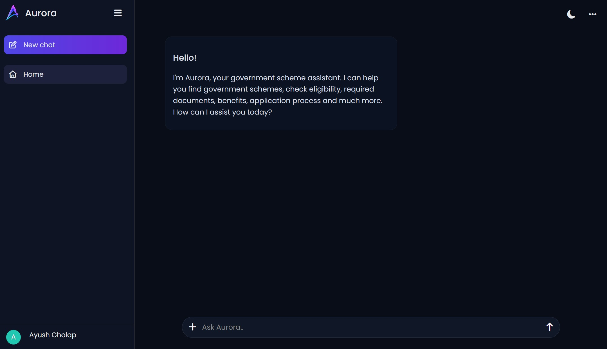

# AURORA 🌌

🌟 Welcome to **AURORA – Government Scheme Assistant!** AURORA is an AI-powered web application designed to help users explore Indian government schemes and understand their eligibility criteria, benefits, required documents, and application procedures through an interactive chatbot. 🌟

## 🕶 Preview



## 📝 Overview

AURORA aims to make information about Indian government schemes more accessible and easier to understand. Instead of searching through multiple websites, users can ask questions through a conversational interface and receive AI-generated guidance about relevant government schemes.

The project uses a React-based frontend, a Python Flask backend, and Google's Gemini API to process queries and generate responses.

## 💎 Key Features

- **AI-Powered Chatbot:** Ask questions about Indian government schemes in natural language.
- **Scheme Information:** Get guidance about scheme benefits, eligibility criteria, required documents, and application procedures.
- **Interactive Chat Interface:** Communicate with AURORA through a user-friendly conversational interface.
- **Modern UI:** Explore a clean, modern interface designed to make information easier to access.
- **AI-Generated Responses:** Receive answers generated using the Gemini API.
- **Responsive Design:** Designed to provide a convenient experience across different screen sizes, where responsive styling is implemented.

## 🛠️ Technologies Used

- **React.js:** Build the interactive frontend and user interface.
- **CSS3:** Style the application and create its visual layout.
- **Python:** Implement backend logic and process requests.
- **Flask:** Handle API endpoints and communication between the frontend and AI service.
- **Google Gemini API:** Generate responses to users' government scheme queries.
- **Git & GitHub:** Manage source code and collaborate on development.

## 🚀 Getting Started

To run AURORA locally, follow these steps:

### 1. Clone the repository

```bash
git clone https://github.com/ayushgholap2104/Aurora-.git
cd Aurora-
```

### 2. Set up the backend

Navigate to the backend directory:

```bash
cd backend
```

Create and activate a virtual environment:

```bash
python -m venv venv
venv\Scripts\activate
```

Install the required dependencies:

```bash
pip install -r requirements.txt
```

Configure your Gemini API key in the backend's `.env` file, using the environment variable expected by your code.

```env
GEMINI_API_KEY=your_api_key_here
```

Start the Flask server:

```bash
python app.py
```

### 3. Set up the frontend

Open a new terminal and navigate to the frontend directory:

```bash
cd frontend
```

Install the dependencies:

```bash
npm install
```

Start the frontend development server:

```bash
npm run dev
```

Open the local URL displayed in your terminal to access AURORA.

## 🤝 Contributing

Contributions to improve AURORA, enhance its features, or fix bugs are welcome!

1. Fork the repository.
2. Create a new branch for your feature or bug fix:

   ```bash
   git checkout -b feature-name
   ```

3. Make your changes and commit them:

   ```bash
   git add .
   git commit -m "Add feature or fix"
   ```

4. Push your branch:

   ```bash
   git push origin feature-name
   ```

5. Open a pull request on the original repository.

## 🔐 Security

- Never share or commit your Gemini API key.
- Keep your `.env` file out of version control.
- Verify scheme details through official government sources before relying on them.

## 📄 License

Check out the license ✒ [License](LICENSE.txt)

---

